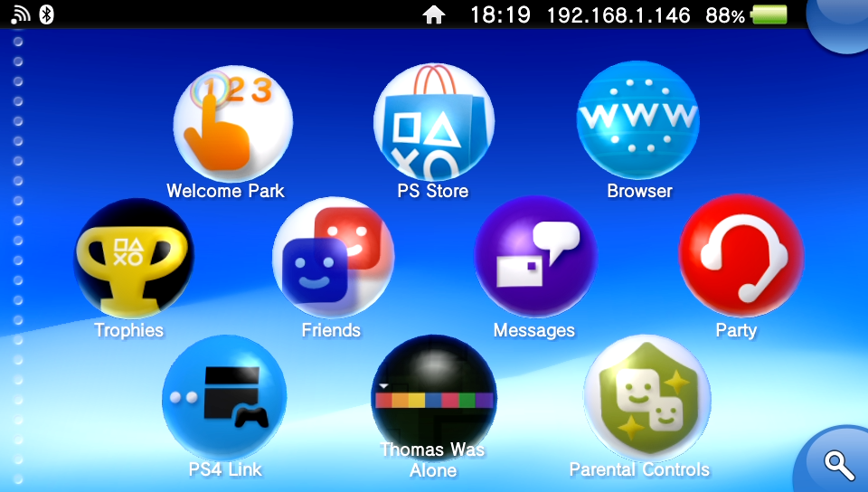
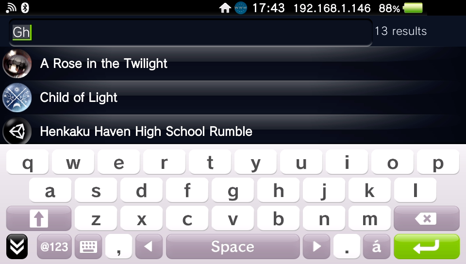
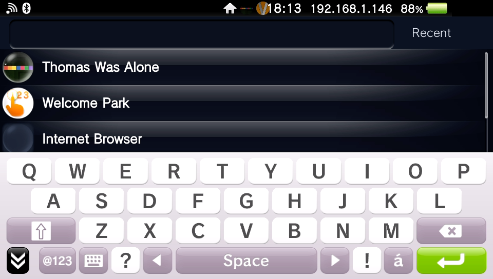
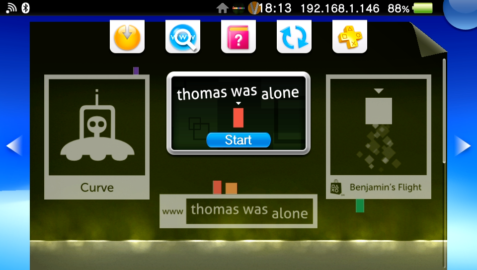

# LiveArea Search

LiveArea Search is a resident SceShell user plugin that adds a native search control to the bottom-right corner of the Vita Home LiveArea. It opens the system keyboard, searches installed applications, shows recent selections, and opens a selected title through the normal LiveArea route.

## Screenshots

<table>
  <tr>
    <td align="center">
      <a href="docs/screenshots/home-search.png"></a><br>
      <sub>Native Search control on the Home LiveArea</sub>
    </td>
    <td align="center">
      <a href="docs/screenshots/search-ime.png"></a><br>
      <sub>Progressive results with the system IME</sub>
    </td>
  </tr>
  <tr>
    <td align="center">
      <a href="docs/screenshots/recent.png"></a><br>
      <sub>Persistent eligible-only Recent list</sub>
    </td>
    <td align="center">
      <a href="docs/screenshots/livearea-launch.png"></a><br>
      <sub>Selected results open the title's native LiveArea</sub>
    </td>
  </tr>
</table>

## Installation

Download the ZIP from the [latest release](https://github.com/devnoname120/livearea-search/releases/latest). It contains a `livearea_search` folder and `install.txt` with the same instructions below.

1. Extract the ZIP and copy the `livearea_search` folder to `ur0:/tai`. It should look like this:
    ```
    ur0:/tai/livearea_search/livearea_search.suprx
    ur0:/tai/livearea_search/livearea_search_plugin.rco
    ```
3. Back up `ur0:/tai/config.txt`, then open it in a text editor.
4. Add the plugin under `*main`. If that section already exists, add only the plugin line. Replace any older LiveArea Search entry instead of adding a second one.
    ```
    *main
    ur0:tai/livearea_search/livearea_search.suprx
    ```

4. Restart your PS Vita.

Recent history stays in `ur0:data/livearea_search/recent_apps.txt`; keep that data directory when upgrading. After restarting successfully with the new version, you can remove the old plugin and RCO files. If a plugin failure prevents SceShell from starting, hold **L** during boot to bypass taiHEN plugins and repair the configuration.

## Building

The Vita target requires:

- Docker;
- a VitaSDK image containing the ARM toolchain and `vita_create_self` tools;
- a complete ScePaf-RE component root containing `include/paf.h` and `lib/libScePaf_stub_weak.a`;
- an executable `psp2cxml-tool` host binary.

`tools/build-vita.sh` defaults to the dependency copies in the sibling VitaXMB checkout used by this workspace and to the pinned VitaSDK image digest `sha256:99814094e0240b7ebe8700ba3742ee761bbcfb22bf8eedeac8db5c1dbe3e3d32`. The verified dependency revisions are:

- `vitasdk-paf-component`: `9a68b07aa2d7247a756765bf154f292cda20aed3`;
- `psp2cxml-tool`: `d971a9a9892c122b4edef15d335326b2a551fec4`.

Override any location as needed:

```sh
LIVEAREA_SEARCH_PAF_ROOT=/absolute/path/to/paf-component/final \
PSP2CXML=/absolute/path/to/psp2cxml-tool \
VITASDK_IMAGE=your-vitasdk-image \
tools/build-vita.sh
```

Optional variables:

- `LIVEAREA_SEARCH_BUILD_DIR` — repository-relative output directory, default `build-vita`;
- `LIVEAREA_SEARCH_JOBS` — parallel build count, default `4`.

Successful output is staged as:

```text
build-vita/dist/livearea_search/livearea_search.suprx
build-vita/dist/livearea_search/livearea_search_plugin.rco
build-vita/dist/install.txt
build-vita/livearea_search.zip
```

The release ZIP contains only the `livearea_search` folder with both plugin files and the top-level `install.txt`. Packaging runs after the release binary audit passes.

## Host tests

```sh
cmake -S . -B build-host \
    -DLIVEAREA_SEARCH_BUILD_TESTS=ON \
    -DLIVEAREA_SEARCH_BUILD_VITA=OFF
cmake --build build-host --parallel 4
ctest --test-dir build-host --output-on-failure
```

## Implementation details

- The Search control is a native lower-right PAF `CornerButton` using Sony's base, highlight, glow, sound, and layout with only the stock ellipsis replaced by a centered magnifying-glass texture. Its bubble keeps Sony's blue corner-button chroma at a lighter value, and the glyph is deliberately smaller than the original prototype. It accepts front-touch input but is excluded from focus, keycode, and analog routing, so it does not interfere with Home navigation.
- Search input uses the Vita IME through a PAF `TextBox`. Results update progressively as the text changes; the keyboard enter/search action only ends editing and expands the result surface.
- The result page owns the complete `960 × 512` area below the Vita information bar. The bar remains visible, while untextured opaque full-width planes cover the Home wallpaper and bubbles without the rounded transparent edges of Sony's dialog-fill texture. A separate non-interactive `80 × 64` PAF occluder at the extreme top-right covers the higher-priority Home notification bubble without mutating SceShell widgets or obscuring the clock, network state, or battery; it exists only for the result-page lifetime.
- The layout uses one `960 × 64` header and one `960 × 448` `ListView` for both editing and expanded modes. While editing, the result page uses priority `36`: behind the system IME view at `35`, but in front of Home at `50`; after editing it returns to the normal display priority. Opaque keyboard rows and held-key preview bubbles therefore render above result rows, icons, glows, recycled cells, and overscroll.
- The result page opens without a page fade and is fully opaque before `BeginEdit`, eliminating the transient half-height layout. Editing changes only focus and control state; it does not resize or reposition the list, replace its camera box, or rebuild its model.
- Back uses PAF's semantic `PAD_ESCAPE` action rather than a physical Circle/Cross mask. While the `TextBox` is editing, Back ends IME editing and keeps Search open; a later Back closes the result page. This preserves the system's X/O assignment.
- One PS-button press closes Search whether the IME is active or already dismissed. Search acquires SceShell's `PS_BTN_2` lock before the result page becomes interactive, filters the PS bit only from the copied PAF sample forwarded to Sony, keeps the result surface present while the physical button is held, and unlocks before deferred teardown after button-up.
- Results use PAF's vertical list layout, kinetic scrolling, focus handling, and 70 px common-list geometry. Each row uses a native `app_icon_simple` widget and one title line.
- Artwork is loaded asynchronously from `ur0:appmeta/<TITLE_ID>/icon0.png`. Visible rows pin their surfaces. Under surface-pool pressure, the cache releases only an unpinned, cache-owned least-recently-used surface and retries the load; evicted entries retain their source path and reload when revisited.
- Search and Recent contain only applications that own a normal Home/LiveArea icon row: an ordinary type-0 icon on a non-sentinel page plus the corresponding SceLsdb category metadata. This excludes background helpers, installers, and system records without relying on a title-ID or category blacklist.
- Eligible results are ranked deterministically: exact title/title-ID, prefix, token prefix, substring, then metadata matches.
- An empty query shows `Recent`: up to 20 unique applications most recently selected through LiveArea Search. The bounded MRU order persists across reboot in `ur0:data/livearea_search/recent_apps.txt`. Saves use a verified same-directory temporary file plus a recoverable backup transaction because Vita file renames do not replace an existing destination.
- Recency is recorded and saved before SceShell is asked to open the title. Launching uses `sceAppMgrLaunchAppByUri(0x20000, "psgm:open?titleid=...")`, so SceShell retains normal application lifecycle ownership.
- The overlay fails closed whenever an application owns the foreground or the required shell state cannot be read. Ordinary navigation away from the Home bubble surface uses the same fast fade as Sony's corner controls, while system-owned surfaces remove Search immediately.
- System overlays retain native ownership. `SceAppMgrAppState::isSystemUiOverlaid` suppresses Search while the PS quick menu is active. A visible system `ime_plugin` yields the lower-right keyboard region, and Home edit/add mode is identified by Sony's full-screen Home scroll plus native Back corner so Search cannot cover the edit controls. For the notification panel, a PAF touchscreen wrapper hides and deactivates Search before forwarding Sony's unchanged touch list; indicator-plugin state keeps the corner suppressed until closure.
- SceLsdb indexing and Recent-history I/O run on the worker thread before the PAF handoff. The worker treats SceShell's unopened AppDB result as a readiness state and retries without blocking the render thread. Before loading its own RCO, the plugin verifies that SceShell's standalone loading scene has been destroyed.
- A missing or unreadable RCO is fail-closed: `module_start` returns `SCE_KERNEL_START_NO_RESIDENT` before creating the state mutex, worker thread, or any PAF plugin state.
- Closing during kinetic scrolling uses a one-frame deferred teardown: input and focus are quiesced before rows, icon notifications, pins, page ownership, and model storage are released.
- Normal release builds never read or mutate `ur0:tai/config.txt`; once installed, they remain active across reboot. Diagnostic experimental builds use a separate startup fail-safe profile.

The implementation does not patch SceShell instructions or use fixed firmware offsets. Firmware, resource, ABI, and binary-audit details are kept under [`docs/firmware`](docs/firmware/).
